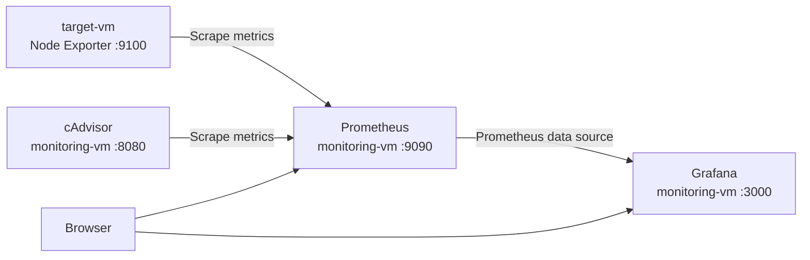

# Prometheus and Grafana Monitoring on Google Cloud

A hands-on monitoring project using **Google Cloud Compute Engine, Docker, Prometheus, Grafana, Node Exporter, and cAdvisor**. The setup collects Linux host metrics and Docker container metrics, visualizes them in Grafana, and demonstrates Prometheus alerting and dashboard variables.

## Architecture



## Infrastructure

Create two Ubuntu 24.04 LTS VMs in **us-central1 / us-central1-a**.

| Setting | `monitoring-vm` | `target-vm` |
|---|---|---|
| Purpose | Prometheus, Grafana, cAdvisor | Node Exporter |
| Machine type | `e2-standard-2` | `e2-medium` |
| Boot disk | Balanced persistent disk, 30 GB | Balanced persistent disk, 20 GB |
| Network tag | `monitoring` | `target` |

### Ports

| Service | Port | VM |
|---|---:|---|
| Prometheus | TCP 9090 | monitoring-vm |
| Grafana | TCP 3000 | monitoring-vm |
| cAdvisor | TCP 8080 | monitoring-vm |
| Node Exporter | TCP 9100 | target-vm |

Create appropriately scoped VPC firewall rules for the required ports. Restrict browser-facing access to your trusted public IP/CIDR where possible. Allow port **9100 only from the monitoring VM's internal IP/CIDR**. Do not expose Node Exporter or cAdvisor publicly unless there is a specific, secured need.

> **Important:** VM external IP addresses can change. Use the current addresses shown in Compute Engine rather than relying on example IPs in notes or terminal history.

## Prerequisites

- A Google Cloud project with Compute Engine enabled.
- Permission to create VMs and VPC firewall rules.
- SSH access to both VMs.
- Docker installed on both VMs.
- Git, if you want to clone this repository.

## 1. Install Docker

Run on **both VMs**:

```bash
sudo apt update
sudo apt upgrade -y
sudo apt install -y docker.io
sudo systemctl enable --now docker
sudo systemctl status docker --no-pager
docker --version
```

## 2. Configure and deploy Prometheus

On `monitoring-vm`, create the configuration directory:

```bash
sudo mkdir -p /opt/prometheus
cd /opt/prometheus
```

Copy this repository's `prometheus.yml` to `/opt/prometheus/prometheus.yml`, or create the file with the configuration below. Update the Node Exporter target if your target VM has a different internal IP.

```yaml
global:
  scrape_interval: 15s
  evaluation_interval: 15s

rule_files:
  - /etc/prometheus/alerts.yml

scrape_configs:
  - job_name: "prometheus"
    static_configs:
      - targets: ["localhost:9090"]

  - job_name: "node-exporter"
    static_configs:
      - targets: ["10.128.0.29:9100"]

  - job_name: "cadvisor"
    static_configs:
      - targets: ["cadvisor:8080"]
```

The configuration above assumes the monitoring VM's Prometheus container and the Node Exporter target use the addresses shown in this demonstration. The `cadvisor` target uses Docker network DNS; connect Prometheus and cAdvisor to the same Docker network in a later step.

Start Prometheus:

```bash
sudo docker run -d \
  --name prometheus \
  --restart unless-stopped \
  -p 9090:9090 \
  -v /opt/prometheus/prometheus.yml:/etc/prometheus/prometheus.yml:ro \
  prom/prometheus
```

Verify the service and logs:

```bash
curl http://localhost:9090/-/healthy
sudo docker logs prometheus --tail 30
```

Open `http://<MONITORING_VM_EXTERNAL_IP>:9090` and navigate to **Status → Targets**. Initially, Prometheus itself should be available.

## 3. Deploy Node Exporter on target-vm

On `target-vm`, run Node Exporter in Docker:

```bash
sudo docker run -d \
  --name node-exporter \
  --restart unless-stopped \
  --net="host" \
  --pid="host" \
  -v "/:/host:ro,rslave" \
  prom/node-exporter \
  --path.rootfs=/host
```

Verify that metrics are being served:

```bash
curl http://localhost:9100/metrics
```

From `monitoring-vm`, test access using the target VM's internal IP:

```bash
curl http://10.128.0.29:9100/metrics | head -10
```

If this fails, check the VM's internal IP, VPC firewall rule, network tags, and Docker container status.

## 4. Validate Prometheus and verify targets

Validate the configuration:

```bash
sudo docker run --rm \
  --entrypoint /bin/promtool \
  -v /opt/prometheus/prometheus.yml:/etc/prometheus/prometheus.yml:ro \
  prom/prometheus \
  check config /etc/prometheus/prometheus.yml
```

After editing the configuration, restart Prometheus:

```bash
sudo docker restart prometheus
curl http://localhost:9090/api/v1/targets
```

Open the Prometheus UI and check **Status → Targets**. Run the PromQL query:

```promql
up
```

A value of `1` indicates that the target is up; `0` indicates a scrape failure.

## 5. Deploy Grafana

On `monitoring-vm`, create persistent storage and run Grafana:

```bash
sudo docker volume create grafana-storage

sudo docker run -d \
  --name grafana \
  --restart unless-stopped \
  -p 3000:3000 \
  -v grafana-storage:/var/lib/grafana \
  grafana/grafana
```

Check its health:

```bash
curl http://localhost:3000/api/health
sudo docker logs grafana --tail 30
```

Open `http://<MONITORING_VM_EXTERNAL_IP>:3000`. The initial Grafana credentials are commonly `admin` / `admin`; change the password when prompted. Do not keep default credentials.

### Connect Grafana to Prometheus

Grafana and Prometheus run in separate Docker containers. A container's `localhost` refers to itself, not the other container. Create a shared network and attach both containers:

```bash
sudo docker network create monitoring
sudo docker network connect monitoring prometheus
sudo docker network connect monitoring grafana
```

If the network already exists or a container is already connected, do not recreate it; inspect it with:

```bash
sudo docker network inspect monitoring
```

Test DNS-based connectivity from Grafana:

```bash
sudo docker exec grafana wget -qO- http://prometheus:9090/-/healthy
```

In Grafana, go to **Connections → Data sources → Add data source → Prometheus** and set the URL to:

```text
http://prometheus:9090
```

Click **Save & test**.

## 6. Create Grafana dashboards

Create a dashboard from **Dashboards → New → New dashboard → Add visualization**. Select the Prometheus data source.

### CPU usage (%)

```promql
100 - (avg by(instance) (rate(node_cpu_seconds_total{mode="idle"}[5m])) * 100)
```

Panel title: **CPU Usage %**. Visualization: **Time series**.

### Memory usage (%)

```promql
100 * (1 - node_memory_MemAvailable_bytes / node_memory_MemTotal_bytes)
```

Panel title: **Memory Usage %**. Visualization: **Time series**.

### Disk read throughput

```promql
rate(node_disk_read_bytes_total[5m])
```

Panel title: **Disk Read Bytes/sec**.

Save the dashboard. You can also import the community **Node Exporter Full** dashboard using dashboard ID **1860** (Grafana may change community dashboard details over time).

## 7. Explore PromQL

Try these queries in Prometheus or Grafana Explore:

| Purpose | Query |
|---|---|
| Target availability | `up` |
| Node Exporter target | `up{job="node-exporter"}` |
| CPU counters | `node_cpu_seconds_total` |
| Total memory | `node_memory_MemTotal_bytes` |
| Network receive rate | `rate(node_network_receive_bytes_total[5m])` |
| Number of scraped targets | `count(up)` |
| Host information | `node_uname_info` |

## 8. Add cAdvisor container monitoring

On `monitoring-vm`, deploy cAdvisor:

```bash
sudo docker run -d \
  --name cadvisor \
  --restart unless-stopped \
  -p 8080:8080 \
  -v /:/rootfs:ro \
  -v /var/run:/var/run:ro \
  -v /sys:/sys:ro \
  -v /var/lib/docker/:/var/lib/docker:ro \
  gcr.io/cadvisor/cadvisor:latest
```

Verify metrics locally:

```bash
curl http://localhost:8080/metrics | head -20
```

Connect cAdvisor to the shared network so Prometheus can resolve the hostname:

```bash
sudo docker network connect monitoring cadvisor
sudo docker exec prometheus wget -qO- http://cadvisor:8080/metrics
```

Validate the Prometheus configuration and restart Prometheus:

```bash
sudo docker run --rm \
  --entrypoint /bin/promtool \
  -v /opt/prometheus/prometheus.yml:/etc/prometheus/prometheus.yml:ro \
  prom/prometheus \
  check config /etc/prometheus/prometheus.yml

sudo docker restart prometheus
```

Check **Status → Targets** in Prometheus and confirm the `cadvisor` job is **UP**.

## 9. Configure a high CPU alert

Create `/opt/prometheus/alerts.yml`:

```yaml
groups:
  - name: host-alerts
    rules:
      - alert: HighCPUUsage
        expr: 100 - (avg by(instance) (rate(node_cpu_seconds_total{mode="idle"}[5m])) * 100) > 80
        for: 5m
        labels:
          severity: warning
        annotations:
          summary: "High CPU usage on {{ $labels.instance }}"
          description: "CPU usage has been above 80% for more than 5 minutes."
```

Validate the rules:

```bash
sudo docker run --rm \
  --entrypoint /bin/promtool \
  -v /opt/prometheus/alerts.yml:/etc/prometheus/alerts.yml:ro \
  prom/prometheus \
  check rules /etc/prometheus/alerts.yml
```

Ensure `prometheus.yml` includes:

```yaml
rule_files:
  - /etc/prometheus/alerts.yml
```

Validate the complete configuration with both files mounted:

```bash
sudo docker run --rm \
  --entrypoint /bin/promtool \
  -v /opt/prometheus/prometheus.yml:/etc/prometheus/prometheus.yml:ro \
  -v /opt/prometheus/alerts.yml:/etc/prometheus/alerts.yml:ro \
  prom/prometheus \
  check config /etc/prometheus/prometheus.yml
```

To load the new rules, recreate Prometheus with both files mounted and on the `monitoring` network. This removes the existing container but **does not remove the host configuration files**:

```bash
sudo docker stop prometheus
sudo docker rm prometheus

sudo docker run -d \
  --name prometheus \
  --restart unless-stopped \
  --network monitoring \
  -p 9090:9090 \
  -v /opt/prometheus/prometheus.yml:/etc/prometheus/prometheus.yml:ro \
  -v /opt/prometheus/alerts.yml:/etc/prometheus/alerts.yml:ro \
  prom/prometheus
```

Check the alert in Prometheus at `http://<MONITORING_VM_EXTERNAL_IP>:9090/alerts`.

> Prometheus evaluates alert rules and displays their state. To deliver notifications, configure an alert receiver such as Alertmanager and the relevant notification integration.

## 10. Add a Grafana host variable

In the dashboard, open **Dashboard settings → Variables → Add variable** and configure:

| Setting | Value |
|---|---|
| Name | `instance` |
| Label | `Host` |
| Type | Query |
| Data source | Prometheus |
| Query type | Label values |
| Label | `instance` |

Update dashboard queries to use the selected host.

CPU:

```promql
100 - (avg by(instance) (rate(node_cpu_seconds_total{mode="idle", instance=~"$instance"}[5m])) * 100)
```

Memory:

```promql
100 * (1 - node_memory_MemAvailable_bytes{instance=~"$instance"} / node_memory_MemTotal_bytes{instance=~"$instance"})
```

The **Host** dropdown lets you switch between instances included in the Prometheus data.

## Troubleshooting

- **Prometheus target is DOWN:** Check the target IP, port, firewall source range, network tags, and whether the exporter is running.
- **Grafana cannot connect to Prometheus:** Ensure both containers are attached to the `monitoring` Docker network and use `http://prometheus:9090` as the data-source URL.
- **cAdvisor target is DOWN:** Confirm the container is running, connect it to the `monitoring` network, and use `cadvisor:8080` in `prometheus.yml`.
- **Configuration fails validation:** Run `promtool check config` before restarting Prometheus; check indentation and mounted file paths.
- **Changes to alert rules are not loaded:** Confirm the file is mounted into the container and recreate/restart Prometheus after validating the configuration.

## Security notes

- Restrict access to Prometheus, Grafana, cAdvisor, and Node Exporter with firewall rules. Prefer private access or trusted source CIDRs.
- Change the initial Grafana password and use strong credentials.
- Do not commit passwords, service-account keys, tokens, or other secrets to Git.
- Keep the VM operating system and container images updated.

## Repository

Source configuration: [`prometheus.yml`](./prometheus.yml)

Repository: https://github.com/SnehalShinde11/-PrometheusGrafana-

---
**Project:** GCP VM Monitoring with Prometheus, Grafana, Node Exporter, and cAdvisor
